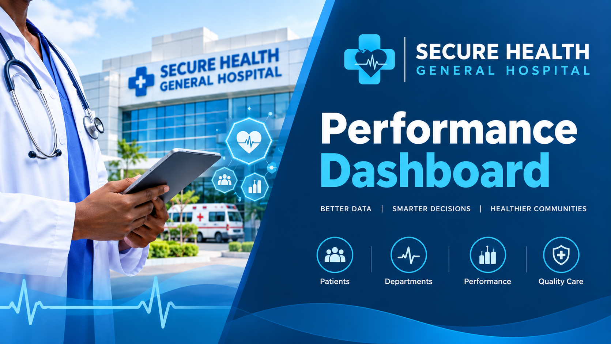
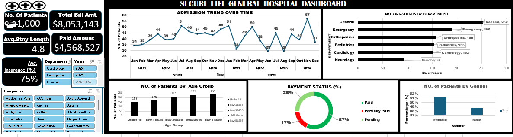

# Secure Health General Hospital Performance Dashboard Excel Data Analytics Project

 # Introduction

 

 This project was completed as part of my training under the **FadaQ Tech Scholarship** Program as an assessment of my data analytics skills and practical understanding of Microsoft Excel.

The project involves analyzing hospital patient data to identify insights into patient admissions, departmental performance, demographics, billing, and payment status. Using Microsoft Excel, I developed a performance dashboard to transform raw data into meaningful visualizations that support data-driven decision-making.

This project demonstrates my practical application of data analysis, data visualization, and dashboard development skills acquired during my training with **FadaQ Tech**.

 # About the Dataset

The dataset used in this project contains hospital patient records for analyzing the performance of Secure Health General Hospital. It includes information relating to patient admissions, demographics, hospital departments, billing, payment status, insurance coverage, and length of stay.

The dataset was analyzed using Microsoft Excel to identify patterns, calculate key performance indicators, and create visualizations for the hospital performance dashboard.

# Problem Statement

Effective hospital management requires accurate insights into patient admissions, departmental performance, demographics, billing, and payment activities. Analyzing these records can help identify trends and areas that require management attention.

This project aims to analyze Secure Health General Hospital's patient dataset using Microsoft Excel and develop an interactive dashboard that presents key performance indicators and meaningful insights to support data-driven decision-making.

# Dashboard Visualization
The dashboard provides a visual overview of hospital performance, including patient admissions, departmental distribution, demographics, billing, and payment status.

Figure 1: Hospital Performance Dashboard created using Microsoft Excel.

# Key Insights

- **Patient Admissions:** The hospital recorded 1,000 patients, with monthly admissions fluctuating throughout the period analyzed.
- **Departmental Performance:** The General Department recorded the highest number of patients (252), while Neurology recorded the lowest (94).
- **Age Distribution:** Patients aged 51–65 formed the largest age group, with 235 patients.
- **Financial Performance:** Total billing amounted to $8,053,143, while total payments reached $4,568,527.
- **Payment Status:** The dashboard shows 57% paid, 17% partially paid, and 26% pending.
- **Average Length of Stay:** Patients stayed an average of 4.8 days.
- **Insurance Coverage:** The dashboard reports average insurance coverage of 75%.
- **Gender Distribution:** Female patients represented approximately 51% of the population, compared with 49% male patients.

These insights highlight differences in departmental workloads, patient demographics, admission trends, and payment patterns, providing useful information to support hospital planning and financial monitoring.

# Recommendations

- **Optimize Resource Allocation:** Allocate staff, medical equipment, and supplies according to patient demand across departments.
- **Monitor Admission Trends:** Track monthly admissions to improve staff scheduling and hospital resource planning.
- **Improve Payment Collection:** Strengthen follow-up on pending and partially paid bills to support better cash flow.
- **Enhance Insurance Management:** Monitor insurance claims and reimbursement processes to reduce delays.
- **Plan for Patient Demographics:** Ensure healthcare services adequately address the needs of different age groups, particularly older patients.
- **Monitor Length of Stay:** Review hospital stays and discharge patterns to support efficient bed utilization without compromising patient care.
- **Update the Dashboard Regularly:** Refresh the data periodically to help management monitor performance and make informed decisions.

Implementing these recommendations could help Secure Health General Hospital improve operational efficiency, strengthen financial monitoring, and support data-driven healthcare management.

# Conclusion

This project demonstrates how Microsoft Excel can be used to analyze hospital patient data and transform it into meaningful insights through an interactive performance dashboard. The analysis highlights key areas such as patient admissions, departmental performance, demographics, billing, and payment status.

Completed as part of my training under the **FadaQ Tech Scholarship Program**, this project has strengthened my practical skills in data analysis, visualization, and dashboard development. It also demonstrates the value of data-driven decision-making in supporting hospital operations, resource allocation, and financial monitoring.

Overall, this project has provided valuable hands-on experience in applying data analytics to real-world healthcare scenarios.
